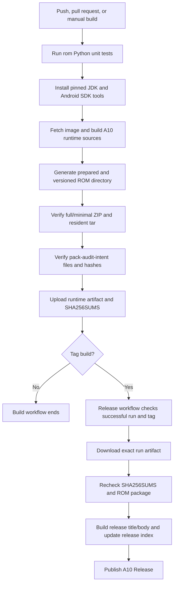

# A10 Release Pipeline

The build workflow proves the selected A10 source can produce prepared data, a ROM package, APK resident libraries, and a valid audit intent. The publish workflow only consumes the artifact from a successful tag build and must not rebuild different bytes.

The workflow runner is Ubuntu 24.04. Source preparation and runtime generation remain inside guest-runtime-a10. The app repository's Gradle build does not produce any A10 ROM payload.

Current limitations: the tag release workflow still carries the existing A10 runtime tar in addition to ROM assets. The app-facing Release asset minimization described by root app docs applies to the app repository, not this runtime repository.
